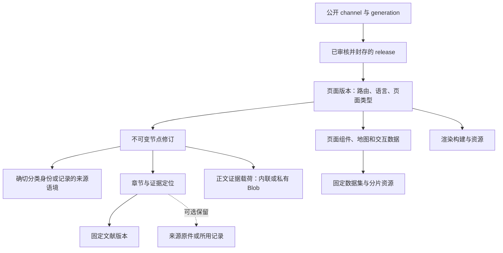

# 页面与完整依赖模型

2026-10-21。实现于同一个 Neon 项目的 `evo_v2` schema，沿用现有 Blob、规范聚合与迁移数据。该模型规定正式页面的发布条件；建立数据结构不等于全站完成依赖导入或线上切换。

## 1. 权威与边界

- 迁移和验收期间，原规范内容仍是当前网站的来源；新依赖图是可核对的私有索引。
- 正式切换后，数据库修订及其对象载荷成为创作权威；Git 只保存代码、SQL 迁移、校验器和必要设计/执行文档。新节点修订、书目修订和发布的 `origin_commit` 可以为空，写入不需要 Git 提交。旧提交号仅作为历史迁移出处保留。
- 正文与证据继续保存一个完整节点聚合；不为每个段落新建一份正文，不在关系表重复文献标题和科学事实。字段/章节使用稳定键与 JSON Pointer 定位原聚合。
- 页面、内容节点、科学身份与资源分别建模。数据库 UUID、页面路由、物理目录名都不是新的科学标识。
- 已有网页、Android、iOS 与未来 worker 共用内容版本；它们的交付形态和安装包保持独立，不把原生平台构建误作 Vercel 函数。

## 2. 内容怎样连到页面



页面根包括实际组件使用的全部内容与数据；只解析正文不能宣称已经覆盖整页。依赖边标明用途与是否必需；同一资源可以供多个页面使用，而底层内容地址只需一份。

## 3. 数据表分工

| 表 | 责任 |
|---|---|
| `dependency_entity` | 稳定的内部对象：page、node、reference、taxon、dataset、resource、renderer；保存记录的身份语境 |
| `dependency_version` | 某对象的不可变版本/描述；用真实外键绑定已有节点修订、书目版本、分类记录、来源发布或文件对象 |
| `dependency_edge` | 某版本依赖另一个具体版本；用途、必需性、章节/字段/记录选择器 |
| `dependency_seal` | 封存当前描述、原生绑定和所有子依赖摘要；记录哈希、是否可发布及缺口 |
| `release_page` | 正式发布明确采用哪些页面版本；语言属于页面身份 |
| `page_release_seal` | 将发布清单绑定到准确候选 hash 的批准和成功校验 |
| `authoring_workspace` / `page_draft_head` | 共享创作空间与页面草稿指针，用 generation 和准确版本比较防止覆盖 |
| `node_draft_head` | 同一节点的事实、证据与双语内容共用一个创作基线，防止不同语言页面各自覆盖同一科学聚合 |
| `page_write_receipt` | 草稿与发布指针更新的幂等回执；固定请求 ID 不得换输入后重用 |

继续复用 `content_node`、`node_revision`、`reference_revision`、`revision_dependency`、`source_release`、`taxon_usage`、`artifact`、`source_snapshot`、`change_set`、`validation_run`、`publication_approval`、`release`、`channel`。不新建另一套平行书目或科学分类数据库。

`node_revision` 保留完整正文/证据；迁移快照使用 `payload_artifact_sha256` 与 `payload_record_id` 选择压缩批次里的实际记录。一个批次可以含多个节点，逻辑依赖只选择本节点，物理文件保留仍以整个 Blob 对象为单位。新写入可使用内联小聚合或独立内容寻址对象，由服务端校验后登记。

### 版本与关系的具体含义

| `role` | 含义与约束 |
|---|---|
| `content` / `component` | 页面使用内容或另一个已声明组件；语言与章节用 selector 选择 |
| `citation` | 使用准确书目版本；SQL 要求目标是 reference，节点书目集合与原生依赖索引完全一致 |
| `identity` / `classification` | 确切来源机构、版本与分类记录，或仅记录的分类来源语境；不从名称或目录猜测等同关系 |
| `payload` | 实际正文、数据或渲染构建文件；SQL 要求资源目标，节点 Blob 载荷不能漏掉 |
| `data` / `media` / `map` / `index` | 数据集、图像、地图、查询/浏览索引等运行依赖，固定资源版本 |
| `source-original` | 保存所用原始材料；默认可以是可选保留，但字段定位、版本与记录的哈希仍在证据中 |
| `renderer` | 固定的页面渲染构建；代码输入哈希不能代替构建已验证的收据与载荷 |

selectors 只存定位，例如 `/evidence/records/catalogue-profile/sources/0`、章节 `type-material`、语言 `zh`、所用批次记录 ID。页码、样本范围和出处说明读取其原聚合位置，避免在索引中复制长文本后发生漂移。

## 4. 各种正式页面的完整依赖边界

| 页面/功能 | 发布根必须声明的依赖 |
|---|---|
| 物种、类群、研究材料阅读 | 节点修订、段落出处、相关研究材料范围、准确分类身份或来源语境、实际图片及阅读渲染组件 |
| 完整分类详情页 | 阅读内容之外，还包括页面实际使用的分类父子/祖先数据、来源清单、权威名称对照、原文描述集合和交互组件；正文适配器不能代替这些声明 |
| 分类树、名称搜索 | 固定分类发布、名称/异名/接受名记录、显式对照关系、搜索和分页数据；索引是可重建投影 |
| 地图、时间轴、化石查询 | 地点与出现记录的确切版本、时间尺度、场景、坐标模型、几何帧/地形网格和组件资源；相同名称不使化石记录自动等同某件正文标本 |
| 故事、阅读主线、专题 | 所使用的节点版本、事件/故事记录、顺序与关系、场景和媒体；跨类群页面可以引用多个独立节点 |
| 来源页与引用面板 | 已采用的文献版本、节点特定定位、来源范围和权利说明；按保存策略选择原件，不自动收集一篇论文全部未采用参考文献 |

事件、故事、地点、材料和地图模型保留各自记录身份。数据集可指向原生固定表，也可由明确的数据资源/子数据集组成；非原生 dataset 必须声明其实际数据依赖。业务查询索引是这些固定记录的派生视图，不是新的科学权威。

## 5. 来源文件的简化策略

每个资源显式记录 `retention`：

1. `citation`：文献引用/来源定位。可以只保存 DOI、URL 与必要书目信息；外部 URL 资源仅允许此策略。
2. `selected-record`：实际采用的记录、正文证据聚合、表格行/必要摘录，保留位置、来源版本及 hash。
3. `full-file`：需要保留整个文件的来源、媒体或运行数据；已保留对象通过 artifact 外键和 hash 关联。
4. `rebuildable`：搜索索引、压缩交付包、渲染构建等可重建产物；发布仍固定本次使用的版本。

`storage` 区分 blob、external、inline、unavailable。`unavailable` 是明确缺口，不能假装已经上传。普通文献不会因缺少 PDF 自动阻断发布；页面必需的地图、图片和数据若缺失则阻断。保留原件的访问权限继续独立记录，依赖边不授予公开下载或再分发许可。

全文、证据记录和其原始出处是不同层次。选择只存 DOI 时仍保留页面实际采用的证据、定位和限定。外部链接无法代替运行所需的数据；模型明确拒绝用 `external + full-file` 冒充已保留的数据实体。

## 6. 完整性与封存

- 一个版本的依赖必须先封存，然后才能封存父版本，因此循环图无法封存。
- 版本、边、封存结果均不可原地修改。封存后不能追加新边，也不能在底层原生节点书目集合或来源分类表中悄悄追加记录。
- 封存摘要包含描述、实际原生记录以及排序后的子依赖摘要；子版本变化必须产生新的父版本。
- `ready=false` 与 blockers 是可审计状态。必需子依赖不完整会传导到页面根；可选原件缺失会记录在完整来源依赖图中，但不会自动阻断页面。
- 同一个正式发布中，一个共享节点或书目必须选用一致版本。内部图对象别名不能绕过原生 node ID / reference ID 的一致性检查。不同语种页面共用同一节点修订。
- SQL 约束负责外键、版本闭包、类型、封存和事务；科学事实是否得到文献支持仍由内容校验、来源核查与用户审核负责。数据库封存不是科学审定。

## 7. 多电脑 worker 与正式发布

worker 通过未来的服务端 API 取得草稿基线，提交新节点修订、依赖图及页面版本；不获取数据库口令。`save_page_draft` 原生函数比较页面 generation/准确旧版本，并对共享节点聚合检查旧修订。不同节点可以独立推进；同一节点的不同语言也会检测冲突。

调用带稳定 request UUID；相同输入返回原回执，重复 ID 换输入会拒绝。跨语言共享节点已更新时，旧页面草稿需要重新基于当前节点构建；不能把两个不同聚合版本拼进一次正式发布。实际 worker 身份、权限、任务租约与 HTTP 接口仍需实现，本轮函数是服务端事务基础，不直接对浏览器开放。

发布步骤：准备并封存依赖 → 形成准确页面清单 → 对清单 hash 完成校验和人工批准 → `seal_page_release` 核对实际清单 → `advance_page_channel` 比较旧 generation 并原子推进。回滚仍推进 generation，但指回旧的已封存发布。现有静态网站不读取这些新指针，本轮没有改变线上内容。

若一个完整站点发布需要保留旧页面，发布构建必须把仍有效的页面也列入新快照，显式删除的页面才省略；不把只有变更页的清单误称完整站点。根页面不应保留尚未声明依赖的隐藏磁盘读取。

## 8. 实际工具与检查

以下命令不新增科学内容到 Git。索引器从已登记的确切迁移映射读取原生修订，再真实读取私有 Blob、核对哈希、解析规范 Markdown 和引用；默认事务回滚，`--apply` 才提交私有依赖索引。

```powershell
rtk proxy node --env-file=.env.local database/migrate.mjs
rtk proxy node --test database/page-dependencies.test.mjs
rtk proxy node --env-file=.env.local database/verify-page-model.mjs
rtk proxy node --env-file=.env.local database/index-page-dependencies.mjs --source-commit 38336ece31d241af0a4fd42a25686641774c2373 --physical-key COL%3A3KTM2 --locale zh --apply
rtk proxy node --env-file=.env.local database/trace-page-dependencies.mjs ffaa640d-c515-5a03-98c2-b91013b04672
rtk proxy node --env-file=.env.local database/trace-page-dependencies.mjs --artifact d3f8e056e6d71d166212b856353302a0109ae7cc5e113e1496a9412ac614fcca --reverse
```

`dependency_closure` 可追踪全部依赖或仅必需依赖；`dependency_referrers` 返回上游页面、历史发布和当前工作区使用情况；CLI 同时显示用途与定位。没有文件删除命令。图未全量覆盖时，查不到上游不能判定旧来源无用。

## 9. 本轮实际验收范围

已在现有开发/预览数据库执行迁移 `0009`–`0015`，保留原 139,458 个节点修订、5,255 条书目与 2,429,092 条分类记录。五个真实节点的英中两种阅读内容已索引为 10 个私有页面版本，并真实执行正向/反向查询。

原生数据库检查覆盖来源策略、依赖缺失/循环、固定书目与分类版本、封存防漂移、批准与校验、回滚、幂等、失效基线、跨语言共享节点冲突及发布版本一致性。全部合成行位于一个最终回滚的事务中，没有留下测试发布或公开 channel。实际数量、SHA 与检查结果见[执行记录](page-dependency-model.execution.json)。

现有自动提取适配器只覆盖 `catalogue-profile` 的节点阅读聚合；未知记录、媒体字段或 Markdown 图片会明确标记覆盖不全。源语境只有来源版本而没有确切分类 ID 时只绑定数据集语境，不从物理目录或 URL 补 ID。本轮的 6G5JP 真实材料验证了这种情况。

10 个页面版本均因为渲染构建尚未验证而保持不可发布。完整分类详情页的权威面板、原文描述、全站地图/搜索/故事等适配器尚未批量接入。本轮交付完整依赖的数据库模型、事务与查询能力，以及真实阅读内容样本，不宣称已经完成全站依赖闭包或网页审核 UI。

没有复制或删除原件、批量上传全 data 仓库、重写 Git 数据历史或切生产。全量扩展依赖索引前要按实际增量测容量，继续保留 850 MiB 水位，不自动升级套餐。旧 `rebuild-unpublished-import.mjs` 已明确禁用于新页面 schema，避免旧重建流程破坏新关系。
